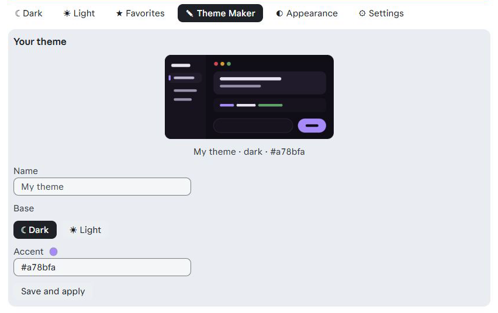

<h1 align="center">
  
</h1>

<p align="center">Dark and light themes for Claude Desktop’s Code tab. Pick a palette or make your own.</p>

<p align="center">
  <a href="https://github.com/adembilge/claude-themes/releases"></a>
  <a href="LICENSE"></a>
  <a href="https://github.com/adembilge/claude-themes/actions/workflows/ci.yml"></a>
</p>

<p align="center">
  <a href="#install">Install</a> ·
  <a href="#themes">Themes</a> ·
  <a href="#theme-maker">Theme Maker</a> ·
  <a href="docs/usage.md">Usage guide</a>
</p>

<p align="center">
  <a href="docs/media/demo.gif"></a>
</p>

## Install

Open a local session in the **Code** tab of Claude Desktop on macOS or Windows. Run each command separately.

```text
/plugin marketplace add adembilge/claude-themes
/plugin install desktop-themes@claude-themes
```

Restart the session, then run **`/claude-themes`** to open the gallery.

For terminal sessions, see [Match the Claude Code terminal](docs/usage.md#match-the-claude-code-terminal).

## Themes

| Tokyo Night | Rosé Pine | GitHub Light |
| :---: | :---: | :---: |
|  |  |  |

In the gallery, search by name, switch between **Dark** and **Light**, or star a palette to find it under **Favorites**.

[Browse 40 theme families in dark and light](docs/media/themes.svg)

## Theme Maker

Choose a dark or light base, enter an accent color and see the palette update as you edit. Save it when the preview looks right.

<p align="center">
  <a href="docs/media/theme-maker.webp"></a>
</p>

[Tune colors and backdrops](docs/usage.md#make-and-tune-a-theme) · [Import a palette](docs/usage.md#import-a-theme) · [Export or share a theme](docs/usage.md#export-or-share-a-theme)

## Commands

| Command | Action |
| --- | --- |
| `/claude-themes` | Open the gallery. |
| `/claude-themes dracula` | Apply Dracula. |
| `/claude-themes github light` | Apply GitHub Light. |
| `/claude-themes follow on` | Follow the system’s light and dark modes. |
| `/claude-themes reset look` | Restore Claude Desktop’s default look. |

[Full command reference](docs/usage.md#command-reference)

## Maintenance

<details>
<summary>Update or uninstall the plugin</summary>

### Update

In a terminal with the Claude Code CLI installed, refresh the marketplace and update the plugin.

```sh
claude plugin marketplace update claude-themes
claude plugin update desktop-themes@claude-themes
```

Restart the Code session to load the update. [Changelog](CHANGELOG.md)

### Uninstall

To restore Claude Desktop’s default look, run `/claude-themes reset look` in the Code tab before removing the plugin.

```sh
claude plugin uninstall desktop-themes@claude-themes
```

For a project or local install, add `--scope project` or `--scope local` to match the installation scope. Restart the Code session after removal.

If you set up terminal matching, choose another terminal theme with `/theme`. You can also remove the generated `~/.claude/themes/claude-themes.json` file.

</details>

[Changelog](CHANGELOG.md)

## License

[MIT](LICENSE) · Use it, change it, ship it.
