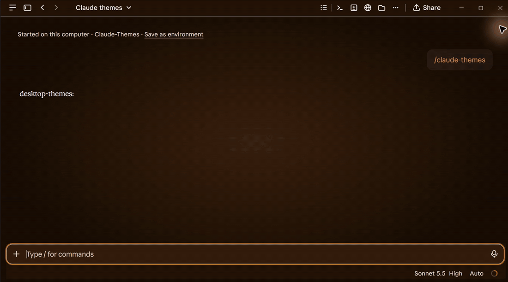
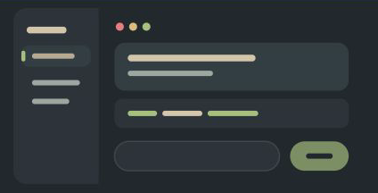
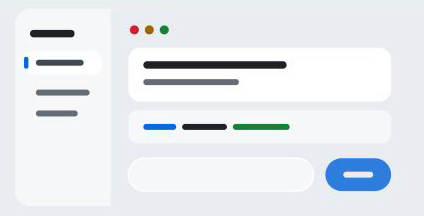
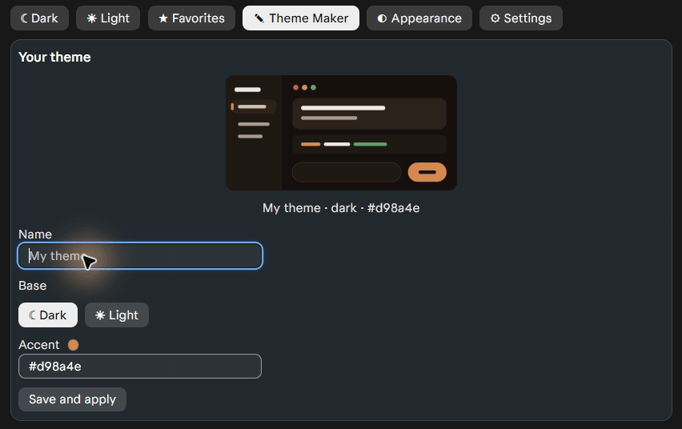

<h1 align="center">
  
</h1>

<p align="center"><em>Pick from 40 palettes, or make one that feels like yours.</em></p>

<p align="center">
  <a href="https://github.com/adembilge/claude-themes/releases"></a>
  <a href="LICENSE"></a>
  <a href="https://github.com/adembilge/claude-themes/actions/workflows/ci.yml"></a>
  <a href="https://adembilge.github.io/claude-themes/guide/"></a>
</p>

<p align="center">
  <a href="#install">Install</a> ·
  <a href="#themes">Themes</a> ·
  <a href="#features">Features</a> ·
  <a href="#theme-maker">Theme Maker</a>
</p>

<p align="center">
  <a href="docs/media/demo.gif"></a>
</p>

## Install

Open a local session in the **Code** tab of Claude Desktop on macOS or Windows. Run each command separately.

```text
/plugin marketplace add adembilge/claude-themes
/plugin install desktop-themes@claude-themes
```

Restart the session, then run **`/claude-themes`** to open the gallery.

For terminal sessions, see [Terminal Matching](docs/handbook/terminal.md).

## Themes

| Tokyo Night | Everforest | GitHub Light |
| :---: | :---: | :---: |
|  |  |  |

[Browse 40 theme families in dark and light](docs/media/themes.svg)

## Features

- **Browse the gallery.** Search by name, switch between **Dark** and **Light**, or star a palette to find it under **Favorites**.
- **Switch from the prompt.** Apply a theme directly with a [slash command](#commands).
- **Make your own theme.** Pick a base and an accent color in [Theme Maker](#theme-maker) and see the palette update as you edit.
- **Bring or share a palette.** [Import a palette](docs/handbook/import-export.md#import-a-palette), then [export](docs/handbook/import-export.md#export-a-palette) or [share it](docs/handbook/import-export.md#share-a-theme).

<details>
<summary>Configure</summary>

- **Tuning and backdrops.** In **Appearance**, adjust warmth, saturation, surface brightness, text contrast, surface tint, accent, and status colors. Choose from nine backdrops and three strengths.
- **Readability.** Strengthen borders and focus rings, match code colors to the palette, soften glare, or use **Night comfort**.
- **Day and night.** Choose a theme for each mode, set a schedule, or use **Follow system**.
- **Folder themes.** Save a theme for the current folder in **Settings**. New sessions in that folder use the saved theme.
- **Terminal matching.** Use **Match terminal to…** in **Settings**, then choose **Claude Themes** from the terminal’s `/theme` menu. [Terminal matching guide](docs/handbook/terminal.md)

</details>

## Theme Maker

Choose a dark or light base, enter an accent color and see the palette update as you edit. Save it when the preview looks right.

<p align="center">
  <a href="docs/media/theme-maker.gif"></a>
</p>

[Tune colors and backdrops](docs/handbook/theme-maker.md#tune-appearance) · [Import, export, or share a theme](docs/handbook/import-export.md)

## Commands

| Command | Action |
| --- | --- |
| `/claude-themes` | Open the gallery. |
| `/claude-themes dracula` | Apply Dracula. |
| `/claude-themes github light` | Apply GitHub Light. |
| `/claude-themes follow on` | Follow the system’s light and dark modes. |
| `/claude-themes reset look` | Restore Claude Desktop’s default look. |

[Full command reference](docs/handbook/commands.md)

## Maintenance

<details>
<summary>Update</summary>

In a terminal with the Claude Code CLI installed, refresh the marketplace and update the plugin.

```sh
claude plugin marketplace update claude-themes
claude plugin update desktop-themes@claude-themes
```

Restart the Code session to load the update.

</details>

<details>
<summary>Uninstall</summary>

To restore Claude Desktop’s default look, run `/claude-themes reset look` in the Code tab before removing the plugin.

```sh
claude plugin uninstall desktop-themes@claude-themes
```

For a project or local install, add `--scope project` or `--scope local` to match the installation scope. Restart the Code session after removal.

If you set up terminal matching, choose another terminal theme with `/theme`. You can also remove the generated `~/.claude/themes/claude-themes.json` file.

</details>

[Changelog](CHANGELOG.md)

## License

[MIT](LICENSE) · Use it, change it, ship it.
