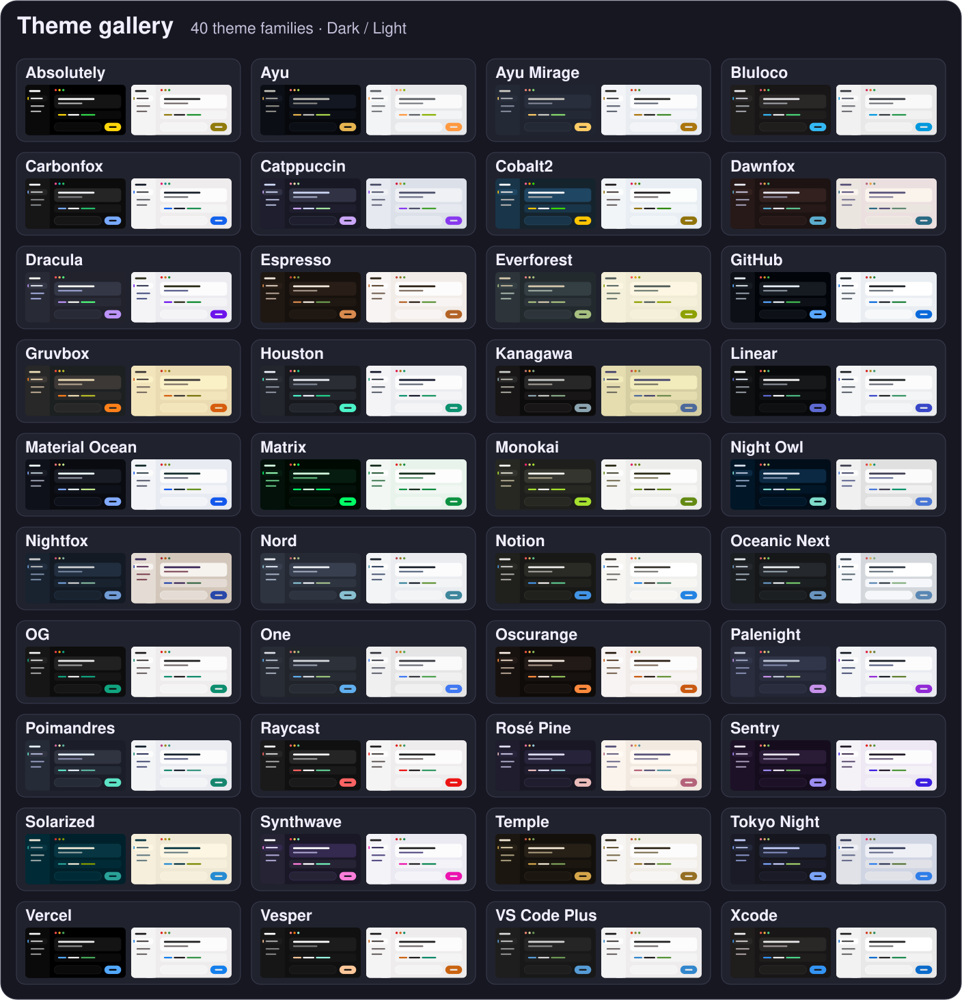

<h1 align="center">
  
</h1>

<p align="center"><em>Pick from 41 palettes, or make one that feels like yours.</em></p>

<p align="center">
  <a href="https://github.com/adembilge/claude-themes/releases"></a>
  <a href="LICENSE"></a>
  <a href="https://github.com/adembilge/claude-themes/actions/workflows/ci.yml"></a>
  <a href="https://code.claude.com/docs/en/plugins"></a>
  <a href="docs/usage.md"></a>
</p>

<p align="center">
  <a href="#install">Install</a> ·
  <a href="#features">Features</a> ·
  <a href="#themes">Themes</a> ·
  <a href="#configure">Configure</a> ·
  <a href="CHANGELOG.md">Changelog</a>
</p>

<p align="center">
  <a href="docs/media/demo.gif"></a>
  <br>
  <em>Animated theme preview</em>
</p>

## Install

Open a local session in the **Code** tab of Claude Desktop on macOS or Windows. Run each command separately.

```text
/plugin marketplace add adembilge/claude-themes
/plugin install desktop-themes@claude-themes
```

Restart the session, then run **`/claude-themes`** to open the gallery.

Themes recolor the Code tab. Other Desktop pages use Claude’s own appearance. To use the same palette in a terminal session, see [Match the Claude Code terminal](docs/usage.md#match-the-claude-code-terminal).

## Features

- **Browse and preview.** Search by name or description. Use **Dark** and **Light** to preview each mode, then select a theme to apply it. Star themes to keep them in **Favorites**.
- **Switch from the prompt.** Jump straight to a theme with a [slash command](#commands).
- **Build your own.** Pick a base mode and an accent in **Theme Maker**. Preview the palette and see any contrast adjustments before saving.
- **Bring or share a theme.** [Import a palette](#import), export it for another tool, or [share it with a link or code](#share).

## Themes

All 41 built-in themes have a dark and a light look. Open the gallery image to zoom in.

[](docs/media/themes.svg)

**Hand-authored pairs**

Ayu, Catppuccin, Everforest, GitHub, Gruvbox, Kanagawa, Night Owl, Nightfox, One, Rosé Pine, Solarized, Tokyo Night.

**Themes with a generated counterpart**

Absolutely, Ayu Mirage, Bluloco, Carbonfox, Cobalt2, Dawnfox, Dracula, Espresso, Houston, Linear, Lobster, Material Ocean, Matrix, Monokai, Nord, Notion, Oceanic Next, OG, Oscurange, Palenight, Poimandres, Raycast, Sentry, Synthwave, Temple, Vercel, Vesper, VS Code Plus, Xcode.

## Configure

- **Tuning and backdrops.** Open **Appearance** to adjust warmth, saturation, surface brightness, text contrast, surface tint, accent, and status colors. Choose from nine backdrops and three strength levels.
- **Readability.** In **Appearance**, strengthen borders and focus rings, match code colors, soften glare, or give the palette a warmer cast with **Night comfort**.
- **Day and night.** Set the day and night themes under **Appearance**. Pick hours or use **Follow system** to switch with the system’s light and dark modes.
- **Folder themes.** In **Settings**, save a theme for the current folder. New sessions in that folder use the saved theme.
- **Terminal matching.** In **Settings**, choose **Match terminal to…**, then select **Claude Themes** from `/theme` in the terminal. [Terminal matching guide](docs/usage.md#match-the-claude-code-terminal)

## Import

Open **Import** in **Settings** or run `/claude-themes import <code, link, path or address>`. You can import a Claude-Themes share code or link, or a palette from VS Code, base16/base24, Windows Terminal, or iTerm2. [Accepted formats and examples](docs/usage.md#import-a-theme)

## Share

Open **Share** at the bottom of **Theme Maker**. **Copy link** gives you a browser preview, and **Copy code** gives you a line to paste into **Import**. You can also export the palette for VS Code, base16, or Windows Terminal. [Sharing and export guide](docs/usage.md#export-or-share-a-theme)

## Commands

| Command | Action |
| --- | --- |
| `/claude-themes` | Open the gallery. |
| `/claude-themes dracula` | Apply Dracula. |
| `/claude-themes github light` | Apply GitHub Light. |
| `/claude-themes follow on` | Follow the system’s light and dark modes. |
| `/claude-themes reset look` | Restore Claude Desktop’s default look. |

[Full command reference](docs/usage.md#command-reference)

## Update

In a terminal with the Claude Code CLI installed, refresh the marketplace and update the plugin.

```sh
claude plugin marketplace update claude-themes
claude plugin update desktop-themes@claude-themes
```

Restart the Code session to load the update. [Changelog](CHANGELOG.md)

## Uninstall

To restore Claude Desktop’s default look, run `/claude-themes reset look` in the Code tab before removing the plugin.

```sh
claude plugin uninstall desktop-themes@claude-themes
```

For a project or local install, add `--scope project` or `--scope local` to match the installation scope. Restart the Code session after removal.

If you set up terminal matching, choose another terminal theme with `/theme`. You can also remove the generated `~/.claude/themes/claude-themes.json` file.

## License

[MIT](LICENSE) · Use it, change it, ship it.
